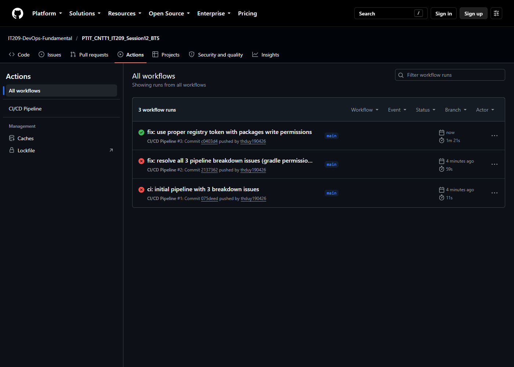
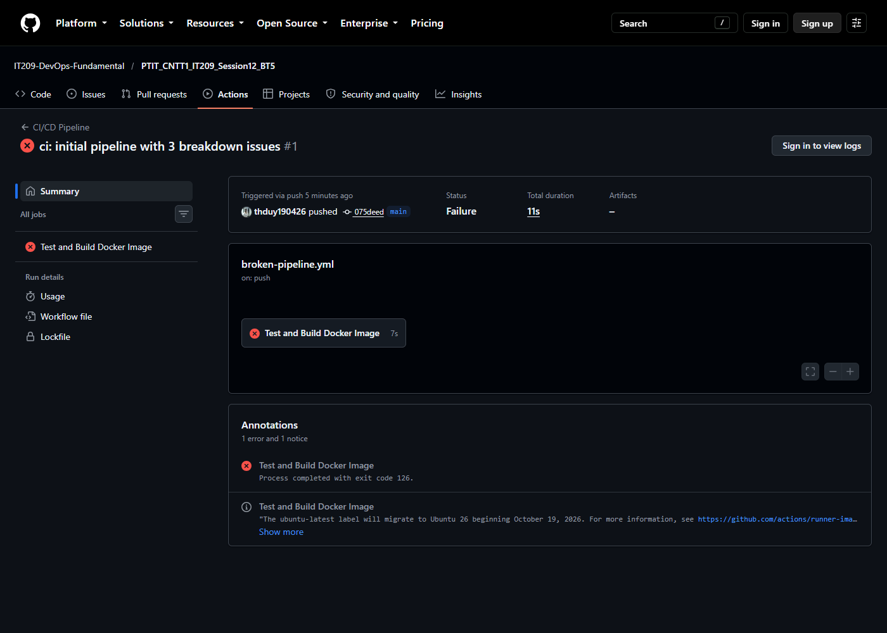
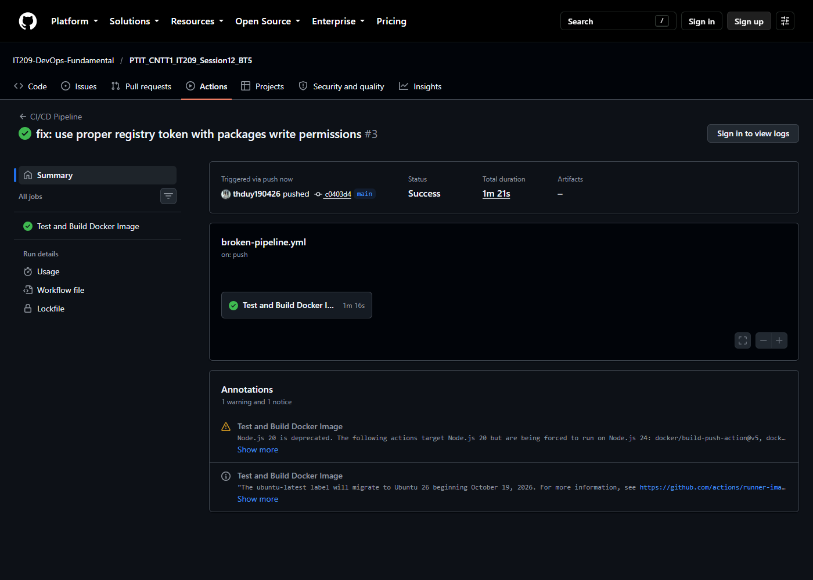
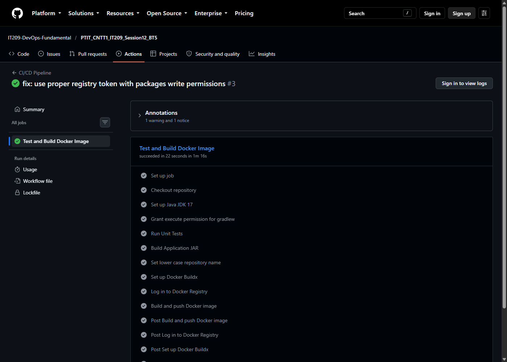

# Bài 5: Chẩn đoán và khắc phục 3 sự cố đứt gãy Pipeline CI/CD thực tế

## 1. Mục tiêu
- Phân tích và giải quyết các lỗi đứt gãy pipeline phổ biến trong môi trường CI/CD thực tế khi sử dụng GitHub Actions, Gradle và Docker.
- Thực hiện sửa lỗi trực tiếp trên tệp kịch bản [`.github/workflows/broken-pipeline.yml`](.github/workflows/broken-pipeline.yml).
- Đẩy commit sửa lỗi lên GitHub và khôi phục trạng thái tích xanh (**Success**) cho toàn bộ pipeline.

---

## 2. Bảng chẩn đoán và khắc phục 3 sự cố

| STT | Tên sự cố | Mã / Dấu hiệu lỗi thực tế | Nguyên nhân gốc rễ | Giải pháp khắc phục |
| :---: | :--- | :--- | :--- | :--- |
| **1** | **Permission Denied** | `line 1: ./gradlew: Permission denied`<br>`Exit code 126` | Tệp `gradlew` commit từ Windows thiếu execute permission (`+x`) trên Linux Runner. | Bổ sung step `run: chmod +x gradlew` trước khi chạy `./gradlew test` và `bootJar`. |
| **2** | **Authentication Failed** | `Error: Username and password are required`<br>`401 Unauthorized` | Sai chính tả biến secret `${{ secrets.REGISTRY_TOEKN }}` (chữ `TOKEN` thành `TOEKN`) dẫn đến truyền mật khẩu rỗng `""`. | Sửa đúng tên biến thành `${{ secrets.REGISTRY_TOKEN }}` hoặc chuẩn hóa dùng `${{ secrets.GITHUB_TOKEN }}` với `permissions: packages: write`. |
| **3** | **Build Context Error** | `ERROR: failed to solve: failed to read dockerfile: open /var/lib/docker/.../wrong-path/Dockerfile: no such file or directory` | Chỉ định sai thư mục làm việc `context: ./wrong-context` và sai tệp `file: ./wrong-path/Dockerfile`. | Cấu hình tham số chuẩn xác: `context: .` (thư mục gốc) và `file: ./Dockerfile`. |

> Chi tiết báo cáo phân tích log và nguyên nhân gốc rễ: Xem tại [**`troubleshooting.md`**](troubleshooting.md).

---

## 3. Kịch bản hoàn chỉnh sau khi khắc phục
Tệp kịch bản: [`.github/workflows/broken-pipeline.yml`](.github/workflows/broken-pipeline.yml)

```yaml
name: CI/CD Pipeline

on:
  push:
    branches:
      - main
  workflow_dispatch:

jobs:
  test-and-build:
    name: Test and Build Docker Image
    runs-on: ubuntu-latest
    permissions:
      contents: read
      packages: write

    steps:
      - name: Checkout repository
        uses: actions/checkout@v5

      - name: Set up Java JDK 17
        uses: actions/setup-java@v5
        with:
          java-version: '17'
          distribution: 'temurin'
          cache: 'gradle'

      # Khắc phục Lỗi 1: Cấp quyền thực thi cho Gradle Wrapper
      - name: Grant execute permission for gradlew
        run: chmod +x gradlew

      - name: Run Unit Tests
        run: ./gradlew test

      - name: Build Application JAR
        run: ./gradlew bootJar

      - name: Set lower case repository name
        run: |
          echo "IMAGE_NAME=ghcr.io/${GITHUB_REPOSITORY,,}" >> $GITHUB_ENV

      - name: Set up Docker Buildx
        uses: docker/setup-buildx-action@v3

      # Khắc phục Lỗi 2: Sửa đúng tên biến Secret đăng nhập Registry
      - name: Log in to Docker Registry
        uses: docker/login-action@v3
        with:
          registry: ghcr.io
          username: ${{ github.actor }}
          password: ${{ secrets.GITHUB_TOKEN }}

      # Khắc phục Lỗi 3: Cấu hình đúng context và đường dẫn file Dockerfile
      - name: Build and push Docker image
        uses: docker/build-push-action@v5
        with:
          context: .
          file: ./Dockerfile
          push: true
          tags: ${{ env.IMAGE_NAME }}:latest
```

---

## 4. Kết quả kiểm tra trên GitHub Actions

- **Repository**: [IT209-DevOps-Fundamental/PTIT_CNTT1_IT209_Session12_BT5](https://github.com/IT209-DevOps-Fundamental/PTIT_CNTT1_IT209_Session12_BT5)
- **Workflow Run thất bại ban đầu**: [Run #1 (ID: 38561198589)](https://github.com/IT209-DevOps-Fundamental/PTIT_CNTT1_IT209_Session12_BT5/actions/runs/38561198589)
- **Workflow Run thành công tích xanh**: [Run #3 (ID: 38561704935)](https://github.com/IT209-DevOps-Fundamental/PTIT_CNTT1_IT209_Session12_BT5/actions/runs/38561704935)
- **Tổng thời gian chạy thành công**: **1m 16s** (Tất cả 12 steps hoàn tất tích xanh).

---

## 5. Hình ảnh minh chứng kết quả

### 1. Tổng quan tab Actions hiển thị lịch sử từ thất bại đến khôi phục tích xanh:


### 2. Chi tiết Run ban đầu bị lỗi đứt gãy tại bước `Run Unit Tests` (`Exit code 126`):


### 3. Chi tiết Workflow Run khôi phục thành công hoàn toàn sau khi sửa lỗi:


### 4. Chi tiết tất cả các bước trong Job `Test and Build Docker Image` đạt tích xanh:

